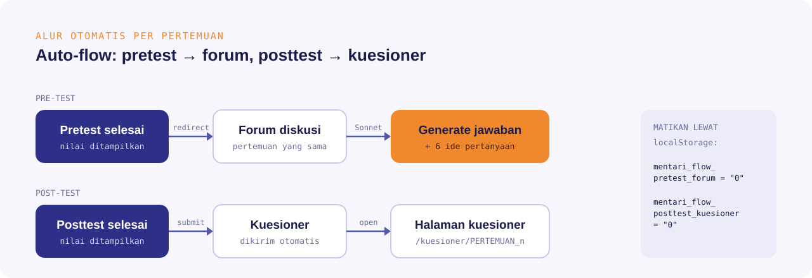
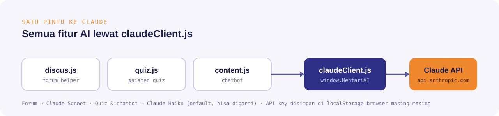

<div align="center">
  

  <br><br>

  
  
  
  
</div>

## Tentang

**Mentari Mod — Claude Edition** adalah versi modifikasi dari [Mentari Mod v2.0 Sunset](https://github.com/Lukman754/Mentari-Unpam) karya **Lukman Muludin**, ekstensi browser untuk LMS **MENTARI** Universitas Pamulang.

Versi aslinya pakai Google Gemini dan udah ga di-maintain lagi. Di fork ini, semua fitur AI dipindah ke **Claude API (Anthropic)**, ditambah helper forum diskusi dan alur otomatis antar halaman per pertemuan.

## Yang beda dari versi asli

| | Versi asli | Claude Edition |
|---|---|---|
| Mesin AI | Google Gemini | Claude API (Anthropic) |
| Model forum | Gemini | Claude Sonnet, lebih bagus buat jawaban esai |
| Model quiz & chatbot | Gemini | Claude Haiku (bisa diganti) |
| Ide pertanyaan forum | — | 6 ide pertanyaan sederhana per topik |
| Revisi jawaban | — | Singkat & Natural, Ringkas, 1 Paragraf, Perjelas, Perpanjang, Nomor |
| Auto-flow | — | Pretest → forum, posttest → kuesioner |
| Tema | default | Neon theme |

## Fitur

### Forum helper
- **Generate jawaban** dari isi topik diskusi, ditulis natural kayak tulisan mahasiswa, otomatis diawali *"Saya izin menjawab,"*.
- **6 ide pertanyaan** sesuai topik, tinggal pilih satu (tiap forum wajib 1 pertanyaan), otomatis diawali *"Saya izin bertanya,"*.
- **Tombol revisi** buat ngubah gaya jawaban tanpa nulis prompt ulang.
- Soal hitungan dikerjain lengkap sampai hasil akhir, bukan cuma narasi.

> Pakai jawabannya buat **pembanding** jawaban lo sendiri, bukan buat di-copas mentah.

### Auto-flow per pertemuan



### Fitur bawaan versi asli
- Pelacakan forum diskusi yang lagi jalan tanpa buka satu-satu
- Asisten quiz dengan pengaturan delay
- Rekap presensi di my.unpam.ac.id
- Isi kuesioner cepat (QuickSurvey)
- Chatbot AI di halaman MENTARI

## Arsitektur AI



Semua pemanggilan AI lewat satu file, `src/content/claudeClient.js` (`window.MentariAI`). Mau ganti model atau endpoint, cukup ubah di situ.

## Screenshot

<!-- Taruh screenshot di folder docs/ lalu ganti baris di bawah -->
<!--  -->

*Segera ditambahkan.*

## Instalasi

1. Download repo ini (**Code → Download ZIP**) lalu ekstrak.
2. Buka `chrome://extensions/` (atau `edge://extensions/`, `brave://extensions/`).
3. Nyalakan **Developer mode** di pojok kanan atas.
4. Klik **Load unpacked**, pilih folder hasil ekstrak (yang ada `manifest.json`-nya).
5. Buka [mentari.unpam.ac.id](https://mentari.unpam.ac.id) dan login.

## Setup API key Claude

1. Bikin API key di [console.anthropic.com](https://console.anthropic.com) (butuh saldo/credit).
2. Pas pertama buka MENTARI, popup API key muncul otomatis. Tempel key-nya di situ.
3. Key disimpan di `localStorage` browser lo sendiri dan cuma dikirim ke `api.anthropic.com`.

Ganti model lewat Console browser:

```js
// model forum (default: Sonnet)
localStorage.setItem("mentari_forum_model", "claude-haiku-4-5-20251001");

// matiin auto-flow
localStorage.setItem("mentari_flow_pretest_forum", "0");
localStorage.setItem("mentari_flow_posttest_kuesioner", "0");
```

> [!WARNING]
> Jangan pernah commit API key ke repo. Key yang bocor di repo publik bisa langsung dipakai orang lain dan nguras saldo lo.

## Struktur folder

```
├── manifest.json
├── src/
│   ├── content/
│   │   ├── claudeClient.js   # pintu ke Claude API
│   │   ├── apiKeyManager.js  # popup & verifikasi API key
│   │   ├── discus.js         # forum helper
│   │   ├── autoFlow.js       # pretest → forum, posttest → kuesioner
│   │   ├── quiz.js           # asisten quiz
│   │   ├── kuisioner.js      # kuesioner otomatis
│   │   ├── neonTheme.js      # tema neon
│   │   └── ...
│   ├── popup/
│   └── assets/
└── docs/                     # gambar README
```

## Kredit

- Project asli: **[Mentari Mod](https://github.com/Lukman754/Mentari-Unpam)** oleh [Lukman Muludin](https://github.com/lukman754), dirilis dengan MIT License.
- Modifikasi Claude Edition: **[zVertiXx](https://github.com/zVertiXx2)** (Feri Pahriansya, Teknik Informatika UNPAM).

## Lisensi

[MIT License](LICENSE). Copyright notice pembuat asli tetap dipertahankan sesuai ketentuan lisensi.

> Project ini dibuat buat belajar dan dipakai pribadi, ga berafiliasi resmi dengan Universitas Pamulang.
